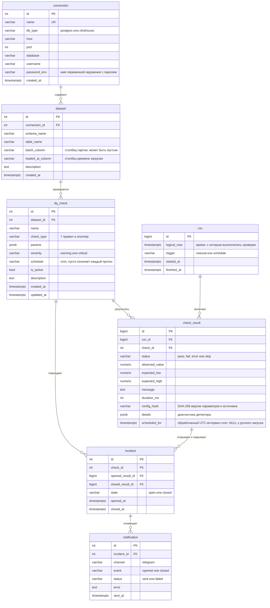

# Модель данных базы метаданных

Схема соответствует миграции `20261031_c3f5b7d9e021_schedule_slots`.
Во всех таблицах заданы первичные и внешние ключи; внешние ключи с `ON DELETE RESTRICT`,
поэтому удалить запись, на которую ссылается история, невозможно.

## Ограничения сверх ключей

| Таблица | Ограничение | Смысл |
|---|---|---|
| dataset | UNIQUE (connection_id, schema_name, table_name) | таблица регистрируется один раз |
| dq_check | UNIQUE (dataset_id, name) | имена проверок не повторяются в пределах таблицы |
| check_result | UNIQUE (run_id, check_id) | в одном прогоне проверка выполняется один раз |
| check_result | UNIQUE (check_id, scheduled_for) | один результат на cron-интервал; ручные NULL не конфликтуют |
| incident | уникальный индекс по check_id при state = 'open' | не больше одного открытого инцидента на проверку |
| incident | CHECK state_consistency | у открытого инцидента нет даты закрытия, у закрытого она обязательна |
| все перечисления | CHECK ... IN (...) | недопустимое значение статуса или типа не запишется |
